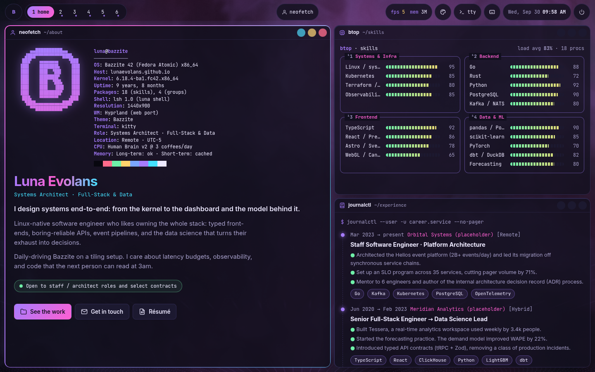
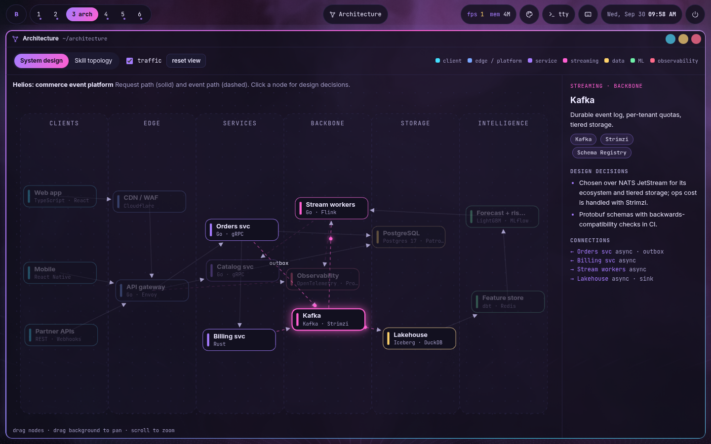
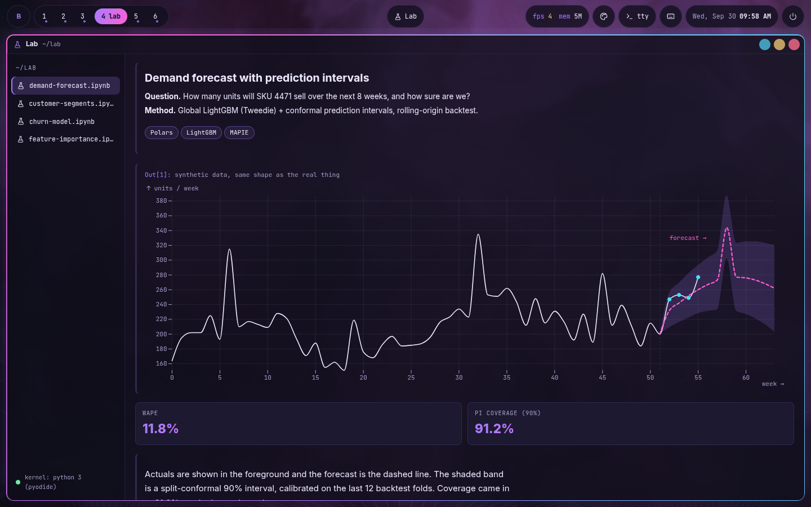
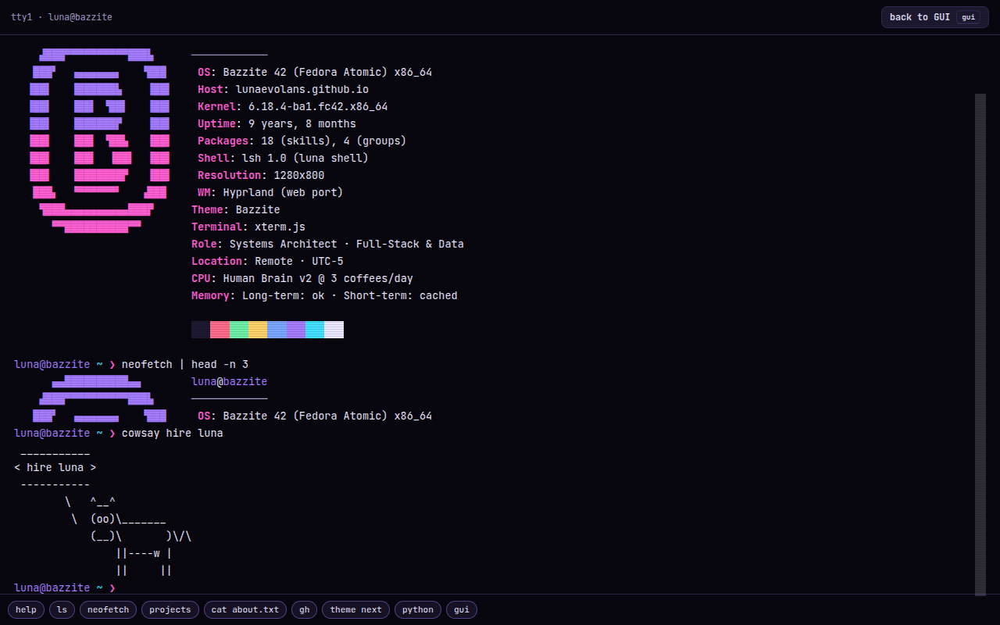
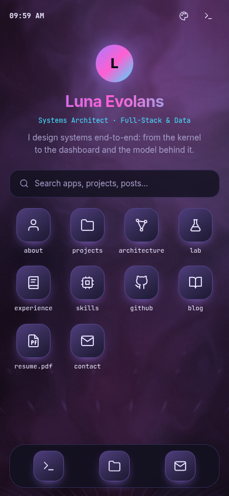

# lunaevolans.github.io

> A portfolio disguised as a riced **Bazzite / Hyprland** desktop: tiling windows, a real shell, a WebGL wallpaper, live GitHub data, an interactive architecture diagram, and a data science lab that runs CPython in your browser.



| Architecture canvas                                | Lab (Plot + Pyodide)                   |
| -------------------------------------------------- | -------------------------------------- |
|  |        |
| **TTY mode**                                       | **Mobile shell**                       |
|                    |  |

## What's inside

|                          |                                                                                                                                                                                                                                          |
| ------------------------ | ---------------------------------------------------------------------------------------------------------------------------------------------------------------------------------------------------------------------------------------- |
| **Desktop (default)**    | Waybar-style bar, 6 workspaces, dwindle tiling with float, fullscreen, and drag/resize, Hyprland keybinds, a rofi launcher (`Ctrl+K`), mako-style toasts, and a cmatrix screensaver with a lock screen                                   |
| **Apps**                 | `neofetch` about · `btop` skills · `journalctl` experience · projects file manager · live `gh dash` · architecture canvas (d3-force) · data science lab (Observable Plot + Pyodide) · devlog · `neomutt` contact form · `zathura` résumé |
| **TTY mode**             | Full-screen xterm.js running `lsh`: a POSIX-ish shell with pipes, `&&`/`\|\|`, tab completion, history, a virtual FS built from your content, and 70 commands, plus a `python` REPL                                                      |
| **Themes**               | Bazzite · Catppuccin Mocha/Latte · Tokyo Night · Gruvbox · Nord · Rosé Pine. One palette file drives the CSS, shader, terminal, and charts                                                                                               |
| **Mobile**               | Phone-style launcher with app sheets, swipe-back, and a dock                                                                                                                                                                             |
| **Boring-but-important** | Static HTML for every page (SEO, no-JS fallback), RSS, sitemap, generated OG images, printable résumé + PDF, WCAG AA on every theme (axe-tested), `prefers-reduced-motion` support, and Lighthouse budgets in CI                         |

**Easter eggs:** `sudo`, `rm -rf /`, `sl`, `vim` (try leaving), `cowsay`, `fortune`, `ujust hire-luna`, `cmatrix`, `apt`, the Konami code, and a few more.

## Make it yours

Everything personal lives in two places:

| File                          | What                                                                                                    |
| ----------------------------- | ------------------------------------------------------------------------------------------------------- |
| `src/config/site.ts`          | Name, title, bio, links, email, career start year, skill meters, **Web3Forms key** for the contact form |
| `src/content/projects/*.md`   | Case studies (frontmatter: title, summary, stack, metrics, links, featured, order)                      |
| `src/content/blog/*.md`       | Posts                                                                                                   |
| `src/content/lab/*.md`        | Data science notebooks (`chart: forecast \| clusters \| roc \| importance`)                             |
| `src/content/experience.json` | Jobs, for the journal app and the résumé                                                                |
| `src/content/architecture.ts` | Nodes and edges for the architecture canvas                                                             |
| `src/lib/themes.ts`           | Palettes                                                                                                |

All placeholder content is marked `TODO` or "(placeholder)". Schemas are Zod-validated, so a typo fails the build instead of shipping. After editing, run `npm run build && npm run resume:pdf` to refresh `public/resume.pdf` (CI regenerates it on deploy anyway).

**Contact form:** get a free access key at [web3forms.com](https://web3forms.com) and paste it into `site.web3formsKey`. Until then the form falls back to opening a pre-filled `mailto:`.

## Develop

```bash
npm install
npm run dev          # http://localhost:4321
npm run check        # astro check (types)
npm run lint         # eslint
npm test             # vitest: shell parser, VFS, commands, tiling, themes, GitHub helpers
npm run build
npm run test:e2e     # playwright: desktop, terminal, mobile, and axe on all 7 themes
```

Handy URLs: `/?boot` replays the boot sequence, `/?mode=tty` opens straight into the shell, and `/?app=lab` (or `architecture`, `contact`, `project&slug=helios`…) deep-links to an app.

## Deploy

GitHub Actions builds and deploys on every push to `main` (`.github/workflows/deploy.yml`). The workflow reads the Pages URL from `actions/configure-pages`, so the same code works at any of these:

- `https://lunaevolans.github.io/portfolio/`: the current repo name
- `https://lunaevolans.github.io/`: rename the repo to **`lunaevolans.github.io`** (Settings → General → Repository name)
- a custom domain: add it under Settings → Pages

One-time setup: **Settings → Pages → Build and deployment → Source: GitHub Actions.**

## Architecture

```
content/*.md ──► astro build (SSG) ──► static HTML + OG PNGs + RSS + sitemap ──► GitHub Pages
                       │
                       └─► one Preact island (Desktop)
                             ├─ nanostores: WM state, theme, mode, toasts
                             ├─ lib/wm: pure dwindle layout + window store + keybinds
                             ├─ lib/shell: parser → Shell (70 cmds) → VFS built from content
                             └─ lazy chunks: xterm · d3-force · Observable Plot · OGL shader · Pyodide (CDN)
```

The full write-up is at `/colophon`.
